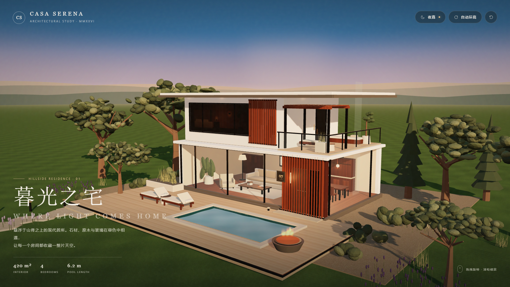

# CASA SERENA · 暮光之宅

一个完全程序化生成的现代山居 3D 场景：白色悬挑体量、整面落地玻璃、原木格栅、山间泳池与暮色花园。场景支持实时旋转、缩放和黄昏 / 夜晚灯光切换，并附带可导入 Blender、C4D 等软件的 GLB 模型。



## 直接查看

双击 **`index.html`** 即可在 Chrome / Edge 中打开。页面已内置 Three.js 打包文件，不需要安装依赖，也不需要联网或启动服务器。

> 需要支持 WebGL 2 的浏览器；建议使用独立显卡以获得更流畅的阴影与抗锯齿效果。

## 交互

| 操作 | 效果 |
| --- | --- |
| 鼠标左键拖拽 / 单指滑动 | 环绕观察建筑 |
| 滚轮 / 双指捏合 | 拉近、拉远 |
| 右上角「夜幕 / 暮色」 | 在黄昏与夜晚之间平滑切换 |
| 右上角「自动环绕」 | 开启或关闭缓慢的自动旋转 |
| 右上角重置图标 | 回到默认构图 |
| 拖拽场景 | 自动暂停环绕 |

夜晚模式会点亮室内暖光、屋檐射灯、庭院灯、泳池水下灯与壁炉火光，并显示星空。

## 文件说明

| 文件 | 内容 |
| --- | --- |
| `index.html` | 页面、界面与排版 |
| `bundle.js` | 打包后的 Three.js 场景（直接可用） |
| `src/house.js` | 完整场景源码：建筑、室内、景观、材质、灯光与交互 |
| `casa-serena.glb` | 独立 3D 模型，约 6 MB，可导入 Blender / C4D / 三维查看器 |
| `preview.png` | 黄昏主视觉 1600 × 900 |
| `preview-night.png` | 夜景 1600 × 900 |
| `preview-detail.png` | 近景细节 |
| `preview-mobile.png` | 手机竖向构图 |
| `tools/screenshot.mjs` | 无头浏览器截图脚本 |
| `tools/export-glb.mjs` | 从场景导出 GLB |
| `tools/browser.mjs` | 自动查找本机 Edge / Chrome，无硬编码路径 |

GLB 包含建筑、室内家具、泳池、庭院与植物；天空、星空、火焰等实时特效由自定义着色器生成，不属于 glTF 标准材质，因此未包含在 GLB 中。泳池水面在 GLB 中以标准材质替代。

## 场景构成

- **建筑**：两层不对称体量、悬挑平屋顶、整面玻璃幕墙、木格栅入口、玻璃栏杆露台、木格栅凉棚。
- **室内**：客厅沙发与茶几、餐区、厨房、地毯、落地灯、挂画、花器与木地板；上层卧室以暖光内景呈现。
- **庭院**：6.2 m 泳池、石材池沿、木平台、躺椅、壁炉、种植池、踏步石与庭院灯。
- **景观**：橄榄树、柏树、灌木、观赏草、野花丛，以及远山与暮色天空。
- **技术**：Three.js r180、程序化 Canvas 纹理、PBR 材质、方向光阴影、PMREM 环境反射、自定义天空 / 水面着色器、GLB 导出。

场景约 9.5 万三角面、550 次绘制调用。

## 相对路径与 GitHub Pages

项目内所有网页资源都使用相对路径，没有写死本机目录：

- `index.html` 通过 `<script src="bundle.js">` 加载脚本；
- README 与预览图使用 `preview.png` 等相对路径；
- 脚本通过 `process.cwd()` 定位项目根目录，不依赖本机工作区路径；
- 截图 / 导出工具会自动查找本机 Edge 或 Chrome，也可以通过环境变量指定。

因此可以把 `villa-3d` 目录里的内容直接作为 GitHub 仓库的根目录；如果放在子目录中，只要保持同样的相对结构也可以。启用 GitHub Pages 时选择对应分支的根目录即可，不需要修改任何路径。

## 开发与重建

需要 Node.js 18+。

```bash
npm install
npm run build       # 重新打包 src/house.js -> bundle.js
node tools/screenshot.mjs
node tools/export-glb.mjs
```

截图与导出脚本会按 `msedge` → `chrome` 的顺序自动查找已安装的浏览器，不包含硬编码的系统路径。如有需要，可以用环境变量覆盖：

```powershell
# Windows PowerShell：优先使用 Chrome（也可设为 msedge）
$env:BROWSER_CHANNEL="chrome"
node tools/screenshot.mjs

# 或者让 BROWSER_PATH 指向浏览器可执行文件
$env:BROWSER_PATH="<浏览器可执行文件>"
node tools/screenshot.mjs
```

```bash
# macOS / Linux
BROWSER_CHANNEL=chrome node tools/screenshot.mjs
BROWSER_PATH="<浏览器可执行文件>" node tools/screenshot.mjs
```
